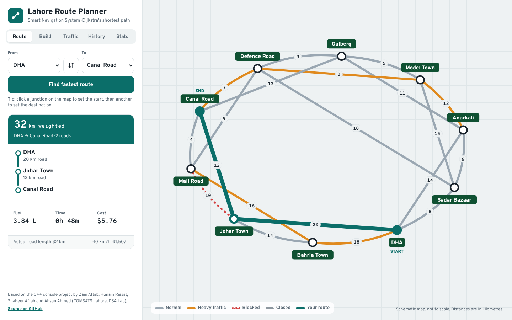
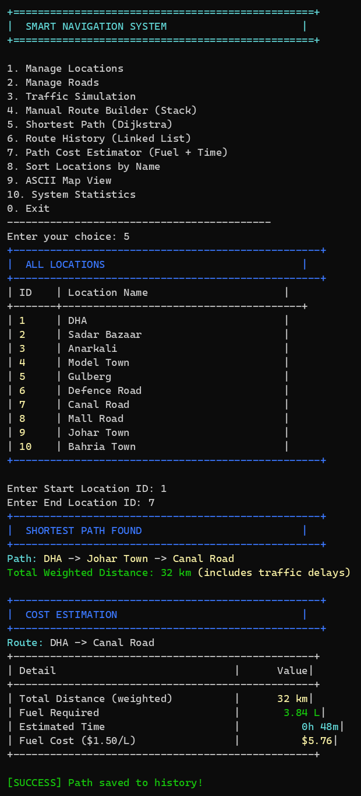

<div align="center">

# 🗺️ Smart Navigation System

A route planner for Lahore, with a C++ console app and an interactive web map, that finds the shortest path with **Dijkstra's algorithm**, reacts to live traffic, and estimates fuel, time and cost for every trip. Built in C++ to demonstrate core data structures and algorithms.




</div>

---

## Web version

The `web/` folder is a browser frontend for the same network and rules. It is plain HTML, CSS and JavaScript with no build step and no dependencies.

- **Schematic map:** ten junction signs on a road-atlas grid; roads are coloured by traffic (grey normal, amber heavy, red dotted blocked, grey dashed closed) and labelled with their distance
- **Route:** pick a start and destination, or click two junctions on the map. The fastest route is drawn on the map with each leg, the weighted distance, fuel, time and cost
- **Build:** add stops one at a time to a stack, with Undo (pop), and save the route to history. Stops must be joined by an open road
- **Traffic:** set each road to Normal, Heavy or Blocked and open or close it; clicking a road on the map jumps to it. The current route updates straight away
- **History:** saved routes in a linked list, newest first
- **Stats:** location and road counts, the traffic breakdown, average road length, and the locations sorted A–Z with selection sort
- Works on phones, supports the keyboard (tabs with arrow keys, junctions with Enter), and remembers traffic and history in `localStorage`

It uses the same weights and cost model as the C++ code, so DHA → Canal Road gives the same 32 km, 3.84 L, 0h 48m and $5.76.

**Run it:** open `web/index.html` in a browser, or serve the folder:

```bash
cd web
python3 -m http.server 8000
# open http://localhost:8000
```

To publish it, enable GitHub Pages for the repository and point it at the `web/` folder (or copy the folder to any static host).

## Console version



### Features

| Menu option | What it does | Data structure / algorithm |
|---|---|---|
| 1. Manage Locations | Add, view and delete locations | Array of `Location` structs, linear search |
| 2. Manage Roads | Add, view, delete roads; change distance, traffic status, one-way flag and availability | Array of `Road` structs |
| 3. Traffic Simulation | Set a road to Normal, Heavy Traffic or Blocked; close a road for construction | Edge weights |
| 4. Manual Route Builder | Push and pop stops to build your own route, then save it | **Stack** (LIFO) |
| 5. Shortest Path | Fastest route between two locations, avoiding blocked and closed roads | **Dijkstra** on a weighted **graph** (adjacency list) |
| 6. Route History | Every saved route, newest first; clear when you like | **Singly linked list** |
| 7. Path Cost Estimator | Distance, fuel, travel time and fuel cost for a route | Dijkstra + cost model |
| 8. Sort Locations | Alphabetical list of locations | **Selection sort** |
| 9. ASCII Map View | Text map of every location and its connections | Adjacency list traversal |
| 10. System Statistics | Counts of locations, roads, traffic states, one-way roads, average distance | Aggregation |

Colour-coded output: green for success and normal traffic, yellow for heavy traffic and key values, red for errors and blocked roads, cyan/blue for headings.

## How routing works

Each road is a weighted edge. Before running Dijkstra the weight is adjusted for traffic:

| Road state | Weight used |
|---|---|
| Normal | distance |
| Heavy traffic | distance × 1.5 |
| Blocked or under construction | road is skipped |

Dijkstra uses distance, visited and parent arrays (O(V²) for V locations) and rebuilds the path from the parent array.

**Cost model** (per weighted km): 0.12 L of fuel, average speed 40 km/h, fuel at $1.50 per litre.
For example, DHA → Johar Town → Canal Road is 32 weighted km: 3.84 L, about 48 minutes, $5.76.

## Pre-loaded network

10 Lahore locations and 20 two-way roads (40 directed edges), with distances from 4 to 20 km and a mix of normal, heavy-traffic and blocked roads:

DHA · Sadar Bazaar · Anarkali · Model Town · Gulberg · Defence Road · Canal Road · Mall Road · Johar Town · Bahria Town

Limits: up to 50 locations and 100 roads.

## Getting started (console)

**Requirements:** any C++11 compiler (g++, clang++, MSVC). Only the standard library is used.

```bash
git clone https://github.com/ZainAftab-dev/Smart-Navigation-System.git
cd Smart-Navigation-System

g++ -std=c++11 -O2 -o nav_system smart_navigation_system.cpp
./nav_system          # Windows: nav_system.exe
```

In Code::Blocks or Visual Studio, add `smart_navigation_system.cpp` to an empty console project and build.

## Try it

| Test | Steps | Expected result |
|---|---|---|
| Shortest path | Option 5, start `1` (DHA), end `7` (Canal Road) | DHA → Johar Town → Canal Road, 32 km |
| Traffic rerouting | Option 3, set a road on that route to Heavy Traffic, then repeat option 5 | A different route if it is now cheaper |
| Blocked road | Option 3, block a road on the route, repeat option 5 | Route avoids the blocked road |
| Manual route | Option 4, push three stops, pop one | Path shows the first two stops (LIFO) |
| History | Option 6 after a few searches | Saved routes listed, newest first |

## Project structure

```
Smart-Navigation-System/
├── smart_navigation_system.cpp   # console app: structs, menus, Dijkstra, stack, linked list, sorting
├── web/
│   ├── index.html                # web app layout: control panel and SVG map
│   ├── style.css                 # road-atlas theme, responsive layout
│   ├── app.js                    # network data, Dijkstra, stack, linked list, map drawing
│   └── fonts/                    # Overpass and Overpass Mono (SIL OFL)
└── docs/
    ├── web.png
    └── screenshot.png
```

Main functions: `shortestPathDijkstra()`, `manualRouteBuilder()`, `pathCostEstimator()`, `trafficSimulation()`, `displayASCIIMap()`, `displaySystemStatistics()`, `sortLocationsByName()`, plus add/view/delete/update functions for locations and roads.

## Known limitations

- The console app keeps data in memory only; changes are lost when the program closes
- Fixed maximum of 50 locations and 100 roads
- The web version uses the fixed ten-location network; adding locations and roads is only in the console app
- The map is schematic, not geographic

## Team

Data Structures and Algorithms Lab, 3rd semester, BS Software Engineering, COMSATS University Islamabad (Lahore Campus).

| Name | Registration No. |
|---|---|
| Zain Aftab | FA24-BSE-155 |
| Hunain Riasat | FA24-BSE-083 |
| Shaheer Aftab | FA24-BSE-089 |
| Ahsan Ahmed | FA24-BSE-074 |

Maintained by **Zain Aftab** · [GitHub](https://github.com/ZainAftab-dev)
